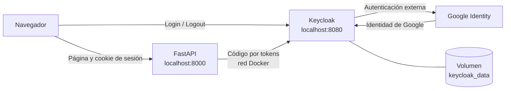
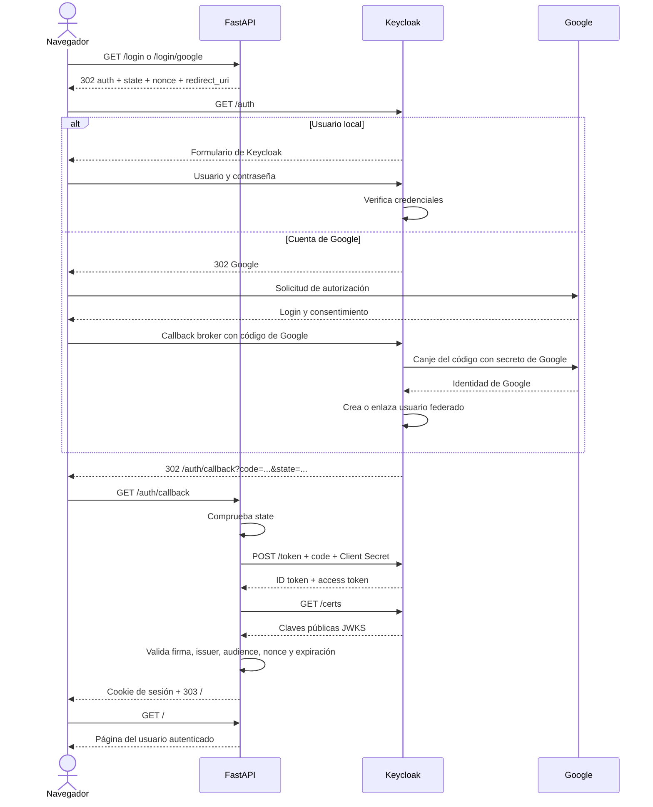

# Keycloak + Google + FastAPI

Aplicación de demostración de autenticación federada con:

- **Keycloak 26.8.2** como servidor de identidad.
- **Google** como proveedor de identidad externo.
- **FastAPI** como backend y cliente OpenID Connect confidencial.
- **Docker Compose** para ejecutar todo el entorno local.

La aplicación utiliza **OpenID Connect Authorization Code Flow**. Después de
autenticarse muestra los datos básicos del usuario y mantiene una sesión local.

## Índice

1. [Arquitectura](#arquitectura)
2. [Responsabilidad de cada componente](#responsabilidad-de-cada-componente)
3. [Estructura del proyecto](#estructura-del-proyecto)
4. [Contenedores y red Docker](#contenedores-y-red-docker)
5. [Configuración de Keycloak](#configuración-de-keycloak)
6. [Configuración de Google Cloud Console](#configuración-de-google-cloud-console)
7. [Conexión entre FastAPI y Keycloak](#conexión-entre-fastapi-y-keycloak)
8. [Flujo completo de autenticación](#flujo-completo-de-autenticación)
9. [Qué datos circulan](#qué-datos-circulan)
10. [Ejecución](#ejecución)
11. [Endpoints](#endpoints)
12. [Persistencia](#persistencia)
13. [Diagnóstico de errores](#diagnóstico-de-errores)
14. [Consideraciones de producción](#consideraciones-de-producción)

## Arquitectura



Hay dos clientes OAuth/OIDC distintos:

| Cliente | Registrado en | Conecta |
|---|---|---|
| `dummy-backend` | Keycloak | FastAPI con Keycloak |
| Cliente OAuth de Google | Google Cloud Console | Keycloak con Google |

No deben compartir Client ID ni Client Secret.

## Responsabilidad de cada componente

### Navegador

- Muestra el frontend servido por FastAPI.
- Sigue las redirecciones de FastAPI, Keycloak y Google.
- Conserva la cookie de sesión de la aplicación.
- Introduce credenciales únicamente en Keycloak o Google.

### FastAPI

- Inicia el flujo de autorización.
- Genera y comprueba `state` y `nonce`.
- Recibe el authorization code de Keycloak.
- Canjea el código desde el servidor usando el Client Secret.
- Valida la firma y los claims del ID token.
- Guarda únicamente datos básicos del usuario en su sesión.

FastAPI **no autentica contraseñas** y no recibe la contraseña de Keycloak ni
la de Google.

### Keycloak

- Es el **Authorization Server** y **OpenID Provider** de la aplicación.
- Gestiona el realm, usuarios, roles, clientes y sesiones.
- Puede autenticar usuarios locales.
- Delega la autenticación a Google cuando se selecciona ese proveedor.
- Crea o enlaza un usuario federado después del login con Google.
- Emite sus propios authorization codes y tokens para FastAPI.

Aunque el usuario entre con Google, FastAPI confía en un token emitido por
**Keycloak**, no directamente por Google.

### Google

- Verifica la cuenta de Google.
- Solicita consentimiento cuando corresponda.
- Devuelve la identidad a Keycloak mediante el broker endpoint.
- No se comunica directamente con FastAPI.

## Estructura del proyecto

```text
.
├── backend/
│   ├── main.py                 # Aplicación, sesión y cliente OIDC
│   └── static/
│       └── styles.css          # Interfaz web
├── .env.example                # Variables de ejemplo, sin secretos reales
├── compose.yml                 # Keycloak, backend, red y volumen
├── Dockerfile                  # Imagen del backend
├── requirements.txt            # Dependencias Python
└── README.md
```

## Contenedores y red Docker

### Keycloak

La sección principal de `compose.yml` es:

```yaml
keycloak:
  image: quay.io/keycloak/keycloak:26.8.2
  command: start-dev
  environment:
    - KEYCLOAK_ADMIN=${KEYCLOAK_ADMIN}
    - KEYCLOAK_ADMIN_PASSWORD=${KEYCLOAK_ADMIN_PASSWORD}
    - KC_HOSTNAME=http://localhost:8080
  volumes:
    - keycloak_data:/opt/keycloak/data
  ports:
    - "127.0.0.1:8080:8080"
```

- `start-dev` habilita un servidor local por HTTP.
- El puerto `8080` solo se publica en la interfaz local.
- `KC_HOSTNAME` hace que el issuer de los tokens sea estable:
  `http://localhost:8080/realms/myrealm`.
- `/opt/keycloak/data` se guarda en el volumen `keycloak_data`.
- El realm, clientes, usuarios, sesiones e Identity Providers sobreviven al
  reinicio de los contenedores.

### Backend

El backend se construye desde `Dockerfile`, ejecuta Uvicorn en el puerto `8000`
y depende de Keycloak:

```yaml
backend:
  build:
    context: .
    dockerfile: Dockerfile
  ports:
    - "127.0.0.1:8000:8000"
  depends_on:
    - keycloak
```

Compose crea una red privada. Dentro de ella, el nombre del servicio
`keycloak` funciona como DNS y apunta al contenedor de Keycloak.

## Configuración de Keycloak

Acceder a <http://localhost:8080/admin> con el administrador definido en
`.env`.

### 1. Realm

Crear o seleccionar:

```text
Realm: myrealm
```

No se debe utilizar `master` para los usuarios de la aplicación. `master` está
destinado a administrar Keycloak.

### 2. Cliente de FastAPI

En **Clients → Create client**:

| Opción | Valor |
|---|---|
| Client type | `OpenID Connect` |
| Client ID | `dummy-backend` |
| Client authentication | `On` |
| Authorization | `Off` para esta demo |
| Standard flow | `On` |
| Direct access grants | `Off` |
| Valid redirect URIs | `http://localhost:8000/auth/callback` |
| Valid post logout redirect URIs | `http://localhost:8000/*` |
| Web origins | `http://localhost:8000` |

`Client authentication: On` convierte al cliente en **confidencial**. En
**Credentials** se genera el Client Secret que debe copiarse a:

```dotenv
KEYCLOAK_CLIENT_ID=dummy-backend
KEYCLOAK_CLIENT_SECRET=valor-generado-por-keycloak
```

El Client Secret nunca debe incluirse en HTML, JavaScript, capturas ni Git.

### 3. Roles

Los roles se pueden crear en **Realm roles**, por ejemplo `test_role`, y
asignar a usuarios desde **Users → Role mapping**.

La autenticación responde “quién es el usuario”. Los roles se utilizan después
para autorización: “qué puede hacer ese usuario”. La aplicación actual
demuestra autenticación y todavía no restringe páginas por rol.

### 4. Usuario local

Para probar sin Google:

1. Ir a **Users → Add user**.
2. Crear el usuario.
3. En **Credentials**, establecer una contraseña.
4. Desactivar `Temporary` si no se quiere cambiar en el primer acceso.

## Configuración de Google Cloud Console

### 1. Crear o seleccionar un proyecto

Abrir [Google Cloud Console](https://console.cloud.google.com/) y seleccionar
un proyecto. La configuración OAuth suele encontrarse en **Google Auth
Platform** o **APIs & Services → Credentials**.

### 2. Configurar la pantalla de consentimiento

Completar como mínimo:

- Nombre de la aplicación.
- Email de soporte.
- Tipo de audiencia.
- Email de contacto.
- Scopes básicos: `openid`, `email` y `profile`.

Si la aplicación está en modo **Testing** con audiencia externa, añadir como
test users las cuentas que podrán iniciar sesión. De lo contrario Google puede
mostrar “Access blocked” aunque la configuración de Keycloak sea correcta.

### 3. Crear el cliente OAuth

Crear una credencial:

```text
Application type: Web application
```

Configurar:

| Campo | Valor |
|---|---|
| Authorized JavaScript origin | `http://localhost:8080` (opcional en este flujo de servidor) |
| Authorized redirect URI | `http://localhost:8080/realms/myrealm/broker/google/endpoint` |

La redirect URI debe coincidir exactamente, incluyendo protocolo, puerto,
realm y ruta. No debe apuntar a FastAPI.

Google entregará:

- Google Client ID.
- Google Client Secret.

### 4. Registrar Google en Keycloak

En el realm `myrealm`:

1. Ir a **Identity providers**.
2. Seleccionar **Google**.
3. Mantener el alias `google`.
4. Pegar el Client ID y Client Secret generados por Google.
5. Guardar.
6. Comprobar que Keycloak muestra esta Redirect URI:

```text
http://localhost:8080/realms/myrealm/broker/google/endpoint
```

Esa misma URI debe estar en Google Cloud Console.

### Relación de callbacks

Hay dos callbacks porque hay dos relaciones OAuth:

```text
Google  ──> /realms/myrealm/broker/google/endpoint ──> Keycloak
Keycloak ──> /auth/callback                          ──> FastAPI
```

Google nunca redirige directamente a `/auth/callback`.

## Conexión entre FastAPI y Keycloak

Las variables usadas por el backend son:

| Variable | Ejemplo | Uso |
|---|---|---|
| `KEYCLOAK_PUBLIC_URL` | `http://localhost:8080` | Redirecciones del navegador e issuer |
| `KEYCLOAK_INTERNAL_URL` | `http://keycloak:8080` | Llamadas servidor a servidor |
| `KEYCLOAK_REALM` | `myrealm` | Realm de la aplicación |
| `KEYCLOAK_CLIENT_ID` | `dummy-backend` | Identificador OIDC |
| `KEYCLOAK_CLIENT_SECRET` | secreto | Autentica al backend |
| `APP_URL` | `http://localhost:8000` | Construye callback y logout |
| `SESSION_SECRET` | valor aleatorio | Firma la cookie local |

### Por qué hay dos URLs de Keycloak

Para el navegador:

```text
http://localhost:8080
```

Para FastAPI dentro de Docker:

```text
http://keycloak:8080
```

Dentro del contenedor del backend, `localhost` significa “este mismo
contenedor”, no el host y tampoco Keycloak. Por eso las peticiones internas al
token endpoint, UserInfo y JWKS utilizan el hostname Docker `keycloak`.

Sin embargo, los tokens mantienen como issuer la URL pública:

```text
http://localhost:8080/realms/myrealm
```

Esto se consigue con `KC_HOSTNAME=http://localhost:8080`.

### Endpoints OIDC utilizados

| Endpoint | Quién lo usa | Propósito |
|---|---|---|
| `/protocol/openid-connect/auth` | Navegador | Iniciar autorización |
| `/protocol/openid-connect/token` | FastAPI | Canjear código por tokens |
| `/protocol/openid-connect/certs` | FastAPI | Descargar claves públicas JWKS |
| `/protocol/openid-connect/userinfo` | FastAPI | Obtener claims de usuario |
| `/protocol/openid-connect/logout` | Navegador | Cerrar sesión en Keycloak |

Authlib configura el scope:

```text
openid profile email
```

`openid` convierte el flujo OAuth 2.0 en OpenID Connect y permite recibir un
ID token.

## Flujo completo de autenticación



### Paso a paso

1. El usuario pulsa **Continuar con Keycloak** o **Continuar con Google**.
2. FastAPI genera `state` y `nonce`, y construye la URL de autorización.
3. `/login/google` añade `kc_idp_hint=google`; esto le indica a Keycloak que
   salte su pantalla y continúe directamente con Google.
4. Keycloak autentica localmente o delega en Google.
5. Keycloak devuelve al navegador un authorization code de un solo uso.
6. El navegador entrega ese código al callback de FastAPI.
7. FastAPI compara `state` con el valor guardado en su cookie de sesión.
8. FastAPI llama al token endpoint por la red privada de Docker.
9. En esa petición envía el código, Client ID, Client Secret y redirect URI.
10. Keycloak invalida el código y devuelve los tokens.
11. FastAPI descarga las claves públicas JWKS y valida el ID token.
12. FastAPI guarda `sub`, `name`, `preferred_username` y `email` en la sesión.
13. El navegador recibe una cookie de sesión, pero no los tokens.

## Qué datos circulan

### Valores de seguridad

| Dato | Para qué sirve | Quién lo ve |
|---|---|---|
| `state` | Evita CSRF y mezcla de flujos | Navegador y FastAPI |
| `nonce` | Evita reutilización de ID tokens | FastAPI y Keycloak |
| Authorization code | Permiso temporal de un solo uso | Navegador, FastAPI y Keycloak |
| Client Secret de FastAPI | Autentica `dummy-backend` | FastAPI y Keycloak |
| Client Secret de Google | Autentica a Keycloak ante Google | Keycloak y Google |
| ID token | Describe la identidad autenticada | Keycloak y FastAPI |
| Access token | Autoriza acceso a recursos protegidos | Keycloak y FastAPI |
| Cookie de sesión | Mantiene la sesión de la aplicación | Navegador y FastAPI |

### Claims usados por la aplicación

| Claim | Significado |
|---|---|
| `sub` | Identificador estable del usuario dentro del realm |
| `name` | Nombre visible |
| `preferred_username` | Nombre de usuario |
| `email` | Correo electrónico |

La cookie de Starlette está firmada con `SESSION_SECRET`, tiene `HttpOnly` y
`SameSite=Lax`. Una cookie firmada no equivale a una cookie cifrada: el cliente
podría leer su contenido, pero no modificarlo sin invalidar la firma. Por eso
esta aplicación no guarda Client Secrets, ID tokens ni access tokens en ella.

### Diferencia entre tokens

- **ID token:** demuestra quién se autenticó y contiene claims de identidad.
- **Access token:** se presenta a una API para acceder a recursos protegidos.
- **Refresh token:** permite solicitar tokens nuevos sin repetir el login. La
  demo no lo guarda ni implementa renovación.

### Flujo de datos con Google

La contraseña de Google solo se introduce en Google. Google devuelve su
resultado a Keycloak, Keycloak normaliza esa identidad dentro de `myrealm` y
emite tokens nuevos. FastAPI recibe la identidad de Keycloak y no necesita
conocer las credenciales OAuth de Google.

## Ejecución

### Requisitos

- Docker con Docker Compose.
- Puertos `8000` y `8080` disponibles.
- Proyecto y cliente OAuth configurados en Google Cloud.

### Variables de entorno

Crear `.env` sin sobrescribir uno existente:

```bash
cp -n .env.example .env
```

Generar un secreto de sesión:

```bash
openssl rand -hex 32
```

Completar `.env`:

```dotenv
KEYCLOAK_ADMIN=admin
KEYCLOAK_ADMIN_PASSWORD=una-clave-local

KEYCLOAK_REALM=myrealm
KEYCLOAK_CLIENT_ID=dummy-backend
KEYCLOAK_CLIENT_SECRET=secreto-copiado-desde-keycloak

SESSION_SECRET=valor-aleatorio-generado
```

`.env` está ignorado por Git. `.env.example` solo contiene placeholders.

### Levantar los servicios

```bash
docker compose up --build -d
```

Abrir:

- Aplicación: <http://localhost:8000>
- Administración de Keycloak: <http://localhost:8080/admin>
- Health check: <http://localhost:8000/health>

### Comandos útiles

```bash
docker compose ps
docker compose logs -f backend
docker compose logs -f keycloak
docker compose restart backend
docker compose down
```

## Endpoints

| Endpoint | Acceso | Función |
|---|---|---|
| `GET /` | Público/sesión | Login o perfil autenticado |
| `GET /login` | Público | Inicia login normal en Keycloak |
| `GET /login/google` | Público | Inicia login con `kc_idp_hint=google` |
| `GET /auth/callback` | Keycloak | Recibe y canjea el authorization code |
| `GET /logout` | Sesión | Borra sesión local y cierra sesión en Keycloak |
| `GET /health` | Público | Estado básico del backend |
| `GET /static/styles.css` | Público | Estilos del frontend |

## Persistencia

El volumen Docker:

```text
keycloak_data
```

está montado en:

```text
/opt/keycloak/data
```

`docker compose down` elimina los contenedores pero conserva el volumen.

> `docker compose down -v` también elimina el volumen y, por tanto, toda la
> configuración, usuarios y datos locales de Keycloak. Solo debe ejecutarse si
> se quiere reiniciar el entorno desde cero.

## Diagnóstico de errores

### `redirect_uri_mismatch` en Google

- Confirmar que la URI autorizada es exactamente:
  `http://localhost:8080/realms/myrealm/broker/google/endpoint`.
- Revisar protocolo, puerto, nombre del realm y barras.
- No usar el callback de FastAPI como callback de Google.

### `Invalid parameter: redirect_uri` en Keycloak

Comprobar en el cliente `dummy-backend`:

```text
Valid redirect URIs = http://localhost:8000/auth/callback
```

### `Access blocked` o usuario de Google no permitido

Si Google OAuth está en modo Testing, añadir la cuenta en **Test users** de la
pantalla de consentimiento.

### `Missing jwks_uri in metadata`

FastAPI necesita:

```text
http://keycloak:8080/realms/myrealm/protocol/openid-connect/certs
```

para obtener las claves públicas y verificar la firma del ID token. La
configuración se encuentra en `backend/main.py`.

### `invalid_code` o “Code already used”

El authorization code solo puede utilizarse una vez. Volver a `/` e iniciar un
login nuevo; no recargar una URL antigua de `/auth/callback`.

### `Restart login cookie not found`

Generalmente ocurre al abrir manualmente una URL intermedia del broker o si las
cookies están deshabilitadas. Iniciar el flujo desde `/login/google`.

### FastAPI no puede conectar con Keycloak

Desde el contenedor se debe usar `http://keycloak:8080`, no
`http://localhost:8080`. Revisar:

```bash
docker compose ps
docker compose logs keycloak
```

### El usuario inicia sesión, pero no ve roles

Autenticación y autorización son procesos distintos. Verificar que:

1. El rol está asignado al usuario.
2. El cliente tiene el scope o mapper correspondiente.
3. El rol está incluido en el access token.
4. El backend valida el claim antes de permitir el recurso.

## Consideraciones de producción

Esta configuración es únicamente educativa. Para producción se debería:

- Utilizar HTTPS para FastAPI, Keycloak y callbacks.
- Sustituir `start-dev` por una configuración de producción.
- Usar PostgreSQL u otra base de datos soportada en vez del almacenamiento de
  desarrollo.
- Guardar secretos en un secret manager, no en archivos.
- Usar credenciales administrativas robustas.
- Marcar la cookie como `Secure`.
- Restringir redirect URIs y web origins sin comodines.
- Desactivar `Full scope allowed` y asignar scopes mínimos.
- Definir expiración, renovación y revocación de sesiones.
- Implementar autorización real para roles.
- Añadir health checks, observabilidad y copias de seguridad.
- Revisar políticas de enlace de cuentas federadas y confianza del email.

## Resumen

La aplicación no conecta directamente con Google. FastAPI confía en Keycloak;
Keycloak puede autenticar localmente o usar Google como proveedor externo.
Después del login, Keycloak emite su propio resultado OIDC, FastAPI lo valida y
crea una sesión reducida para mostrar la aplicación.
